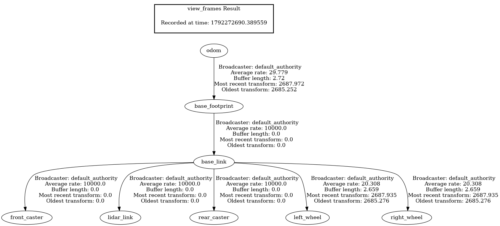
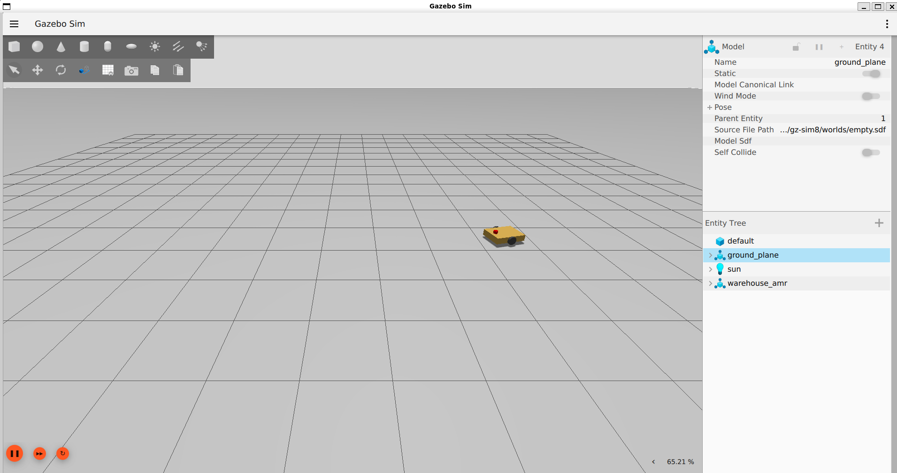

# ROS2 Warehouse Robot

A simulated warehouse robot built with ROS2 Jazzy and Gazebo. It will drive to goals, avoid obstacles, map its environment and carry out pick tasks from a simple task manager. I'm building it step by step to learn ROS2.

## What works so far
- A differential-drive AMR described in URDF/xacro: body, two drive wheels, two casters and a lidar, with collision shapes and inertia
- The robot spawns in Gazebo (Harmonic) and drives with the keyboard
- Gazebo's DiffDrive plugin turns velocity commands into wheel speeds and publishes odometry
- A ros_gz bridge connects Gazebo and ROS (`cmd_vel`, `odom`, `tf`, `joint_states`, `clock`)
- A battery status publisher and a monitor node that warns once when the battery gets low

## TF tree


## Packages
| Package | Contents |
|---|---|
| `warehouse_bot` | Python nodes: battery status publisher and battery monitor |
| `warehouse_description` | Robot model (xacro), RViz and Gazebo launch files, bridge config |

## How to run
```bash
cd ~/warehouse_ws
colcon build --symlink-install
source install/setup.bash

# View the model in RViz
ros2 launch warehouse_description display.launch.py

# Run it in Gazebo
ros2 launch warehouse_description gazebo.launch.py

# Drive it (second terminal)
ros2 run teleop_twist_keyboard teleop_twist_keyboard
```

## Robot in Gazebo 



## Progress
- [x] Workspace and package setup
- [x] Battery status publisher
- [x] Battery monitor (subscriber)
- [x] Robot model in RViz
- [x] Robot in Gazebo, driving with keyboard teleop
- [ ] Lidar and a warehouse world
- [ ] Go-to-goal controller
- [ ] Obstacle stop
- [ ] Parameters
- [ ] Mapping (SLAM)
- [ ] Navigation (Nav2)
- [ ] Task manager